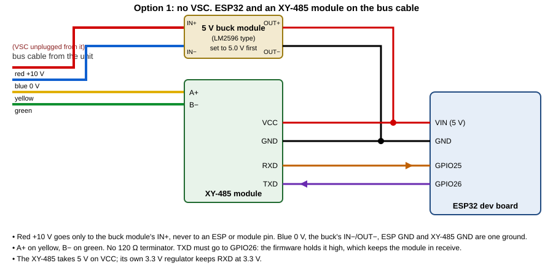
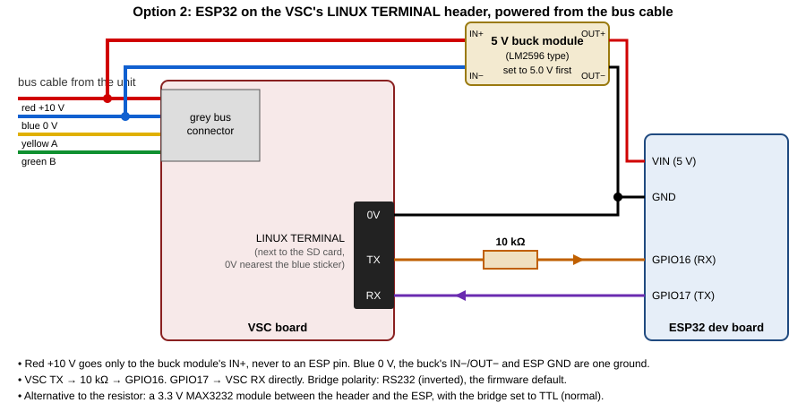

# Nuaire-MVHR

Nuaire MRXBOX in Home Assistant, with an ESP32: either in place of the **VSC / MRX Control** touchscreen, or alongside it.

<p align="center">
  <a href="https://buymeacoffee.com/karwantes"></a>
  <br>
  <b>If this project saved you time or a new controller, a coffee keeps it going. Thank you!</b>
</p>

## Two ways to connect

| | Option 1: no VSC | Option 2: keep the VSC |
|---|---|---|
| How | An ESP32 with an XY-485 module answers the unit on the RS485 bus in the VSC's place | An ESP32 in the VSC's wall box talks to the VSC over its **LINUX TERMINAL** console header |
| Wall screen | None | Keeps working |
| SD card | Not needed | Converted once with `vscconv.exe` (backs up first) |
| Parts | ESP32, XY-485 module, 5 V buck module | ESP32, 10 kΩ resistor, 5 V buck module, SD card reader |
| Power | From the bus cable (red/blue) through the 5 V buck module | Same |
| How-to | **[docs/option1-no-vsc.md](docs/option1-no-vsc.md)** | **[docs/option2-vsc-console.md](docs/option2-vsc-console.md)** |





Both use the same firmware, [esp/vsc-serial-bridge](esp/vsc-serial-bridge/README.md), and both put an **MRXBOX** device into Home Assistant by MQTT discovery (Mosquitto add-on, no YAML). The bridge's own page at `http://vsc-bridge.local/unit` shows the readings and controls without HA.

Download: [latest release](https://github.com/karwantes/Nuaire-MVHR/releases/latest). Discussion: [Nuaire MRXBOX interface for Home Assistant](https://community.home-assistant.io/t/nuaire-mrxbox-interface-for-home-assistant/573933) (HA community).

**Red (+10 V) never goes directly to the ESP**, only to the 5 V buck module's input. Turn the unit off at its isolator before you touch any wiring.

## What you get in Home Assistant

Fan speed 1/2/3, bypass Auto/On/Off and its setpoint, humidity and frost setpoints, night and holiday mode, airflow % for each speed, both temperatures, humidity, running speed, bypass active, run and filter hours, filter change due, fault sensors and communication status. Option 1 adds the VSC's timers (speed 3 limit, night, holiday, bypass override); option 2 adds the screen timeout, the VSC clock and the debug log. Full list: [the bridge](esp/vsc-serial-bridge/README.md#home-assistant-mqtt).

A dashboard card is included with the custom integration: [custom_components/nuaire_mvhr](custom_components/nuaire_mvhr/README.md).

## How the VSC works

```
 touchscreen ── DM355 ARM Linux (es-lcd) ──I²C 0x26── bus chip ──RS485 1200 8N1── MRXBOX unit
```

- The VSC runs Linux from an SD card. The whole UI is one program, `es-lcd`. It never touches RS485 itself: it talks I²C to a bus chip, which answers the unit.
- The unit is the bus master. It polls the VSC in four slots of a fixed cycle; if nobody answers, it runs on its own defaults.
- Option 2 hooks `es-lcd` (a small library added by `vscconv.exe`) and drives it from the console. Option 1 replaces the VSC on the bus.

The full byte-level map, both RS485 and I²C: **[docs/protocol.md](docs/protocol.md)**.

## Things you can use without any hacking

- **Settings → spanner → PIN** opens the Commissioning menu. The installer PIN defaults to `1234`, and the firmware also always accepts `0107`.
- In Commissioning you can set supply and extract airflow % for each speed, plus the bypass, frost and humidity setpoints.
- **Settings → Diagnostics** shows fan status, both temperature sensors, RH, comms, run hours and filter hours.

## Repo layout

| Path | What |
|---|---|
| `docs/option1-no-vsc.md` | Option 1 how-to: wiring, setup, what the emulation does |
| `docs/option2-vsc-console.md` | Option 2 how-to: convert the card, wiring, setup, restore |
| `docs/protocol.md` | RS485 bus and I²C protocol |
| `docs/build-logger-card.md` | Research: build a logger SD image from a copy of your card |
| `docs/images/` | Wiring diagrams, photos, annotated VSC board |
| `esp/vsc-serial-bridge/` | ESP32 firmware for both options |
| `custom_components/nuaire_mvhr/` | HA custom integration (USB serial on the VSC console) and the dashboard card |
| `logger/` | `i2clog.c`, the library `vscconv.exe` adds to the VSC, and its build script |
| `theme/` | Custom dark screen theme and the **Controlled by HASSOS** tick box |
| `tools/vsc-convert/` | `vscconv.py` card converter (backup, convert, restore) and the `vscconv.exe` build |
| `tools/` | `mkimg.py`, `mklogo.py`, `getlog.py`, `armdis.py`: research tools that work on a copy of your card |
| `captures/` | Real logs from one unit |

No firmware, card images, disassembly or Nuaire artwork are published here.

## Disclaimer

Not affiliated with or endorsed by Nuaire. This is interoperability research. Changing your VSC's card or wiring to the bus is at your own risk; keep the backup of your card.
