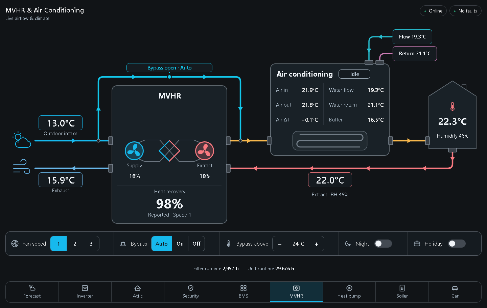
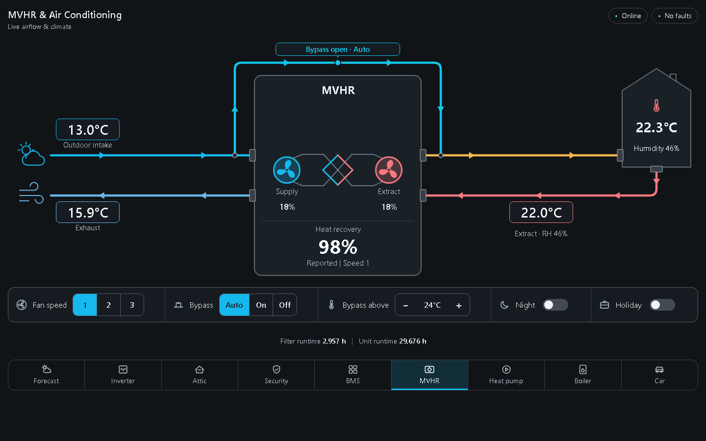
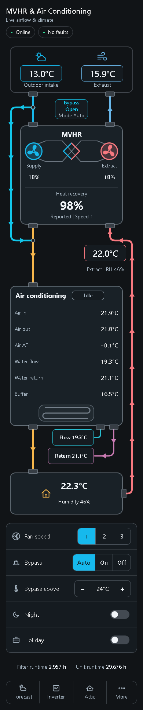

# MVHR airflow card

A Home Assistant dashboard card for a Nuaire MRXBOX. It shows the airflow through the unit, heat recovery, the bypass, temperatures and humidity. It also has controls for fan speed 1/2/3, bypass, night and holiday. The air conditioning coil is optional.



## Before you start

You need these first:

1. **The ESP32 bridge**, wired with [option 1 (no VSC)](../../docs/option1-no-vsc.md) or [option 2 (keep the VSC)](../../docs/option2-vsc-console.md). The bridge is what creates the unit's entities in Home Assistant. The card only draws them.
2. **MQTT in Home Assistant**: the Mosquitto broker add-on and the MQTT integration. Once the bridge is running you'll find an **MRXBOX** device under *Settings → Devices & services → MQTT*, with entities named `mrxbox_…`.
3. **[HACS](https://hacs.xyz/docs/use/)**, if you want to install with the button below. Without HACS, use the manual install.

You don't need any other cards, themes or frontend add-ons. The card is a single JavaScript file.

## Install

### With HACS (recommended)

[](https://my.home-assistant.io/redirect/hacs_repository/?owner=karwantes&repository=Nuaire-MVHR&category=plugin)

1. Click the button. It opens HACS in your Home Assistant with this repository.
2. Click **Download**, then **Download** again.
3. Reload the browser when HACS asks you to (Ctrl+Shift+R, or close and reopen the app).

HACS adds the dashboard resource for you. Updates show up in HACS like any other card.

If the button doesn't work, add the repository yourself:

1. Open **HACS → ⋮ (top right) → Custom repositories**.
2. Repository: `https://github.com/karwantes/Nuaire-MVHR`. Type: **Dashboard**.
3. Search HACS for **MVHR airflow card** and download it.

### Manual

1. Download `mvhr-airflow-card.js` from the [latest card release](https://github.com/karwantes/Nuaire-MVHR/releases?q=card&expanded=true). You can also take it from [`dist/`](../../dist/mvhr-airflow-card.js).
2. Copy it to `/config/www/mvhr-airflow-card.js`, using the File editor or Samba add-on.
3. Go to **Settings → Dashboards → ⋮ → Resources → Add resource**.
   - URL: `/local/mvhr-airflow-card.js?v=1`
   - Type: **JavaScript module**
4. Reload the browser with Ctrl+Shift+R.

After each update, change `?v=1` to a new number so browsers fetch the new file.

## Add the card

The card is wide, so it looks best on its own page:

1. Open a dashboard, click the **pencil** (Edit dashboard), then **+** to add a view.
2. Set **View type** to **Panel (single card)**, give it a title such as *MVHR* and save.
3. In the new view, click **Add card**, search for **MVHR airflow** and pick it.

It also works in a normal Sections or Masonry view, where it switches to a compact or phone layout to fit the space.

## Set it up

The card editor opens with **Setup** expanded:

1. **Unit**: choose your MRXBOX.
2. Click **Fill sensors and controls from unit**. This binds every bridge entity it finds. If the unit has no air conditioning sensors, it also turns the air conditioning part off (see below).
3. **Read-only** is on by default, so the controls show the unit's state but send nothing. Untick it to use fan speed, bypass, night and holiday from the card.
4. Click **Save**.

Check **Sensors** and **Controls** for anything left unbound. **Demo mode** shows sample values and sends no commands, which is handy for trying the layout before the bridge is running.

To change the card later on a panel view, enter edit mode (pencil). A blue **Edit card** button appears at the top right of the card.

## No air conditioning? Turn it off

Most MRXBOX installs have no cooling or heating coil in the supply duct. That part of the card (the *Air conditioning* box and the water flow and return pipes) is optional:

- **Fill sensors and controls from unit** turns it off by itself when there are no coil sensors, and changes the title to *MVHR*.
- To turn it off yourself, open the card editor, go to **Features** and untick **Air conditioning coil**. **Water circuit** goes with it.

In YAML:

```yaml
type: custom:mvhr-airflow-card
features:
  aircon: false
```

The supply duct then runs straight from the unit to the house:



### If you do have a coil

Leave **Air conditioning coil** ticked and bind its sensors under **Sensors**. These come from your own heat pump or climate integration, not from the bridge:

| Sensor | What |
|---|---|
| Air in / Air out | Air temperature before and after the coil |
| Water flow / Water return | Water temperatures at the coil (needs **Water circuit**) |
| Buffer | Buffer tank temperature (optional) |
| Air conditioning status | A climate entity's `hvac_action`, or any sensor reading heating/cooling/idle |

Bind only what you have. Unbound values show as —.

## Other features

All of these are under **Features** and can be turned off:

- **Bypass**: the bypass duct and its badge.
- **Humidity**: humidity in the house and extract.
- **Health**: the Online and Faults pills.
- **Runtimes**: filter and unit hours.
- **Controls**: the control bar.
- **Navigation**: a row of links to your other dashboards (off by default).

On a phone the controls go into one column:



## Troubleshooting

| Problem | Fix |
|---|---|
| *Custom element doesn't exist: mvhr-airflow-card* | The resource isn't loaded. Check *Settings → Dashboards → Resources*, then reload with Ctrl+Shift+R. |
| "No Nuaire MVHR unit found" in Setup | The bridge's MQTT device isn't in HA yet. Check the bridge is online (`http://vsc-bridge.local/unit`) and that MQTT discovery is on. |
| Controls are greyed out | Read-only is on (Setup), you're in the editor preview, or the entity is unavailable. The reason shows in small text under the control. |
| Old version still showing after an update | Ctrl+Shift+R. In the phone app: *Settings → Companion app → Debugging → Reset frontend cache*. |

The 0.2.x card type, `custom:nuaire-mvhr-card`, still works and loads this card. Remove the old `/local/nuaire-mvhr-card.js` and `/local/mvhr-flow-card.js` resources if you still have them.
