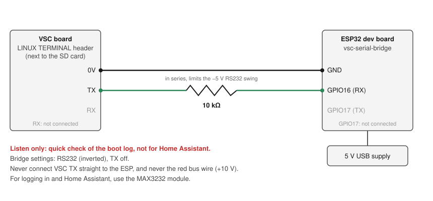

# Home Assistant control: convert the card and add an ESP32

This guide gets the MRXBOX into Home Assistant with your VSC screen still working:

1. Convert the VSC's SD card once in a PC card reader, with `vscconv.exe`.
2. Wire an ESP32 to the VSC's console header.
3. The ESP talks to the VSC over the console and puts the unit into Home Assistant by MQTT.

You need no Linux, no card images and no command line. The tool backs up your card before it changes anything, and it can put the backup back.

## Parts

| Part | Notes |
|---|---|
| ESP32 dev board | "ESP32 Dev Module" type (ESP32-WROOM). On a WROVER board GPIO16/17 are taken, see [the bridge](../esp/vsc-serial-bridge/README.md#wiring). |
| MAX3232 RS232-to-TTL module | 3.3 V capable. The console header is RS232 level, so the ESP can't connect to it directly. |
| 7 jumper wires | 3 from the VSC header to the module, 4 from the module to the ESP. Check the header on your board for the right connector. |
| 5 V USB power supply and cable | Powers the ESP. Don't take power from the VSC or the bus cable. |
| USB SD card reader | For converting the card once on a PC. |
| Windows PC | Runs `vscconv.exe`. Needs free disk space about the size of the card (the backup), 2 GB on a stock card. |
| Optional: 10 kΩ resistor | Only for the [listen-only quick check](#quick-check-with-a-10k-resistor-listen-only) without a MAX3232 module. |
| Optional: 3.3 V MAX3485 module | Listen-only tap on the RS485 bus, see [the bridge](../esp/vsc-serial-bridge/README.md#rs485-bus-tap-optional-listen-only). Not needed for Home Assistant. |

## Connection diagram


| VSC LINUX TERMINAL | MAX3232 module | ESP32 |
|---|---|---|
| 0V | GND (RS232 side) | |
| TX | RS232 RX in | |
| RX | RS232 TX out | |
| | VCC | 3V3 |
| | GND (TTL side) | GND |
| | TTL TX / RXD out | GPIO16 (RX) |
| | TTL RX / TXD in | GPIO17 (TX) |

- The header is silkscreened **LINUX TERMINAL** and sits next to the SD card. 0V is the pin nearest the blue sticker. TX and RX are named from the VSC's side. The board photos are in [images/pcb_front_annotated.jpg](images/pcb_front_annotated.jpg).
- **Never connect the red bus wire (+10 V) to the ESP or the module.**
- If the bridge log shows nothing at all, TX and RX are probably swapped.

### Quick check with a 10k resistor (listen only)

If you don't have a MAX3232 module yet, you can still watch the console, for example to see that a converted card boots to `login:`. You need one 10 kΩ resistor and 2 jumper wires.



| VSC LINUX TERMINAL | | ESP32 |
|---|---|---|
| 0V | wire | GND |
| TX | 10 kΩ resistor in series | GPIO16 (RX) |
| RX | not connected | GPIO17 not connected |

- In the bridge, set the polarity to **RS232 (inverted)** (the default) and turn **TX off**.
- The resistor limits the current from the header's RS232 swing (about −5 V idle) into the ESP pin. **Never connect VSC TX straight to the ESP.**
- **Listen only.** The ESP can't type to the VSC, so it can't log in and Home Assistant gets nothing. For Home Assistant, use the MAX3232 module as above.

## Step by step

### 1. Set up the ESP bridge

1. Flash `esp/vsc-serial-bridge/vsc-serial-bridge.ino` to the ESP32 (Arduino IDE, ESP32 board package, board "ESP32 Dev Module").
2. Power it from USB. Join its WiFi network `vsc-bridge` (password `nuaire123`), open `http://192.168.4.1/wifi` and enter your WiFi details.
3. On your network, open `http://vsc-bridge.local/`. Set the polarity to **TTL (normal)** with the inv button (you are using a MAX3232 module).
4. Open `http://vsc-bridge.local/mqtt` and enter your MQTT broker (for the Mosquitto add-on: the HA address, port 1883 and an HA user).

Full details are in the [bridge README](../esp/vsc-serial-bridge/README.md).

### 2. Convert the card

1. Download `vscconv.exe` from the [latest release](https://github.com/karwantes/Nuaire-MVHR/releases/latest).
2. Power the unit off at the isolator. Take the SD card out of the VSC board.
3. Put the card in the card reader. If Windows offers to format it, press **Cancel**. Close any Explorer window showing the card.
4. Start `vscconv.exe` and accept the admin prompt. It lists the VSC card it finds, for example `disk 3  2.00 GB  stock`. If it says `no VSC card found`, check the reader and press `4` to scan again.
5. Press `1` (convert), then `y`. The tool then:
   - checks that this is a VSC card with the stock boot script (it leaves anything else alone);
   - saves a full backup, `vsc_backup_<date>.img` plus a `.sha256` file. It reads the card twice and checks the file, all by SHA-256. The full path is shown on the `backup ok:` line;
   - changes 26 blocks on the card and reads each one back.
6. Wait for `converted: 26 writes, all verified`. This takes a few minutes; most of it is the backup.

   

   Converting a card that is already converted says `card is converted` and changes nothing.
7. **Keep the backup.** It is your way back to stock.

### 3. Put it back together

1. Put the card back in the VSC.
2. Wire the ESP as in the diagram, with the unit still off.
3. Power the unit on. The VSC screen starts as normal.
4. Watch `http://vsc-bridge.local/`. After the boot messages you should see `(none) login: root`, then the bridge's status lines, for example:
   ```
   @S 1 @T 23 13 49 1 170 254 @R 29661 2942 @C 2 @M 66 0 0 0 @A 18 32 100 18 32 100
   ```
5. In Home Assistant, the **MRXBOX** device appears under Settings → Devices & services → MQTT.

### Going back to stock

Power off, take the card out and start `vscconv.exe`. Press `3` (restore a backup), give the path of your `vsc_backup_<date>.img`, and confirm. The tool checks the file against its `.sha256`, writes the whole card, and reads it back to check it.

## What the conversion changes

- The first 24 KB of `/etc/Wireless/RT2870STA/rt3070sta.ko`, the wifi driver, which this unit never loads, are replaced by `i2clog.so` (built from [logger/i2clog.c](../logger/i2clog.c)). The file keeps its size and place.
- `/autoexec.bat` starts the screen program with `LD_PRELOAD` and in the background, so the boot reaches the console login.

Nothing else on the card changes. The boot logo stays stock. The tool is in [tools/vsc-convert](../tools/vsc-convert/README.md); its Python source runs on Linux too (experimental).

## Tested

- Converted a real card in a USB reader with `vscconv.exe`: backup checked, 26 writes verified. The VSC booted, the bridge logged in and Home Assistant got live data.
- Restore on image copies of a stock card gives the stock image back bit for bit. **Restoring a real card requires further testing.**
- Linux version: tested on image copies and a loop device in WSL. **A real card on Linux requires further testing.**
