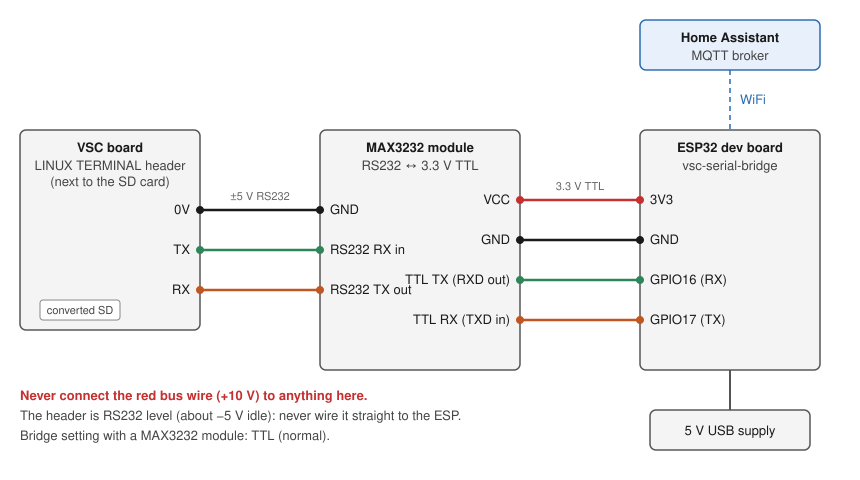

# Home Assistant control: convert the card and add an ESP32

This guide gets the MRXBOX into Home Assistant with your VSC screen still working:

1. Convert the VSC's SD card once in a PC card reader, with `vscconv.exe`.
2. Wire an ESP32 to the VSC's console header.
3. The ESP talks to the VSC over the console and puts the unit into Home Assistant by MQTT.

You need no Linux, no card images and no command line. The tool backs up your card before it changes anything, and it can put the backup back.

## 1. Before you start

### What has been tested

| | Tested |
|---|---|
| Unit | One MRXBOX with the VSC touchscreen controller (TI DM355 board, SD card in the VSC). This is the only unit tested. |
| Card converter | `vscconv.exe` from release [vscconv-1.0](https://github.com/karwantes/Nuaire-MVHR/releases/tag/vscconv-1.0), on Windows 11 with a USB card reader |
| ESP bridge | `esp/vsc-serial-bridge` from this repository as of 24 October 2026, on an ESP32-WROOM dev board, built with Espressif ESP32 board package 3.3.12 |
| Home Assistant | Mosquitto broker add-on and the MQTT integration |

**Other VSC firmware versions require further testing.** The converter checks the card's layout, that `es-lcd` is there and that the boot script is stock. `i2clog.so` calls fixed addresses inside `es-lcd`, so a different build could misbehave. The current `vscconv.py` also checks `es-lcd` is the tested build (by SHA-256) and changes nothing if it isn't, unless you override it (type `yes` in the menu, or `--any-eslcd`). The vscconv-1.0 exe doesn't have this check. If yours is different, the backup puts the card back as it was.

Before you change anything, check that your VSC board looks like [images/pcb_front_annotated.jpg](images/pcb_front_annotated.jpg), with the **LINUX TERMINAL** header next to the SD card.

### Limits to know before you change the card

- **Restoring your own backup** to the same card is tested: it was written back and read back bit for bit. A restored card booting in the VSC **requires further testing**.
- Restoring to a blank or replacement card **requires further testing** (see [Restore and recovery](#9-restore-and-recovery)).
- Keep the backup `.img` **and** its `.sha256` file together, with the names unchanged. The current `vscconv.py` refuses to restore without a matching `.sha256`; the vscconv-1.0 exe only checks it when it is there.

### What HA does and doesn't change

The conversion adds Home Assistant alongside the VSC. It does not take control away from the VSC:

- es-lcd still runs the unit as before: its timers end speed 2/3, night and holiday, and it goes to speed 3 on rising humidity. HA can set everything the screen can, and the screen keeps working.
- **HASSOS mode** ("Controlled by HASSOS") is a separate option in `i2clog.so` that stops es-lcd's own timers and humidity boost so HA runs the schedule. **The converter does not turn it on**, and setting up MQTT doesn't either. The tick box for it only shows with a custom screen theme, which the converter doesn't install. See [theme/README.md](../theme/README.md#hassos-mode-controlled-by-hassos).
- If the ESP, the broker or HA goes away, the VSC carries on by itself with the last settings. HA shows the entities unavailable. **Long outages require further testing.**

### Network security

- The bridge's web page, telnet console (port 23), bus port (2323) and over-the-air update (port 3232) have **no password**. Anyone on your network can use the console, which is a root shell on the VSC.
- The MQTT username and password only let the ESP into the broker. They don't protect the bridge.
- MQTT is unencrypted (port 1883).
- Keep the ESP on a trusted network. **Never forward its ports to the internet.**

## 2. Parts and prerequisites

| Part | Notes |
|---|---|
| ESP32 dev board | "ESP32 Dev Module" type (ESP32-WROOM). On a WROVER board GPIO16/17 are taken, see [the bridge](../esp/vsc-serial-bridge/README.md#wiring). |
| MAX3232 RS232-to-TTL module | 3.3 V capable. The console header is RS232 level, so the ESP can't connect to it directly. |
| 7 jumper wires | 3 from the VSC header to the module, 4 from the module to the ESP. The header's pitch and connector type aren't documented yet: check your board before buying wires. |
| USB data cable | For flashing the ESP. Some cables are charge-only and the PC won't see the ESP. |
| 5 V USB power supply | Powers the ESP. Don't take power from the VSC or the bus cable. |
| USB SD card reader | For converting the card once on a PC. |
| Windows PC | Runs `vscconv.exe` and Arduino IDE. Needs free disk space the size of the card for the backup (2 GB on a stock card). |
| Optional: 3.3 V MAX3485 module | Listen-only tap on the RS485 bus, see [the bridge](../esp/vsc-serial-bridge/README.md#rs485-bus-tap-optional-listen-only). Not needed for Home Assistant. |

You also need:

- Home Assistant with an MQTT broker (step 3).
- A **2.4 GHz** WiFi network that reaches the unit. The ESP32 can't join 5 GHz-only networks.

## 3. Prepare Home Assistant (MQTT)

Do this first, so you know HA is ready before you touch the card.

1. **Broker.** If you don't have one: Settings → Add-ons → Add-on store → **Mosquitto broker** → Install, then Start. Turn on "Start on boot".
2. **Integration.** Settings → Devices & services. HA discovers **MQTT**; press **Add** (or Configure) and accept the defaults.
3. **Login for the ESP.** Settings → People → Users → Add user, for example `mqtt-vsc` with a password. The Mosquitto add-on accepts HA users. Use the user's **password**, not a long-lived access token.
4. **Note the broker address:** your HA's IP address or hostname, for example `192.168.1.10`. Just the address, without `http://` or a port.

**Checkpoint:** Settings → Devices & services → MQTT shows as configured with no error.

## 4. Flash and set up the ESP bridge

### Flash the sketch

1. Install [Arduino IDE](https://www.arduino.cc/en/software) 2.
2. Board package: File → Preferences → **Additional boards manager URLs**, add
   `https://espressif.github.io/arduino-esp32/package_esp32_index.json`.
   Then Tools → Board → Boards Manager, search **esp32** and install **esp32 by Espressif Systems** (3.3.12 tested).
3. Download this repository (green **Code** button → Download ZIP) and unzip it. Open `esp/vsc-serial-bridge/vsc-serial-bridge.ino`. No other libraries are needed.
4. Plug the ESP32 into the PC with the USB data cable. Tools → Board → esp32 → **ESP32 Dev Module**. Tools → Port → the new COM port.
5. Press **Upload** (the arrow). When it ends with `Hard resetting via RTS pin...`, it's done.

If no COM port appears, try another cable, or install the USB driver for the chip on your board (usually CP210x or CH340). If the upload stops at `Connecting....`, hold the board's **BOOT** button until the upload starts.

Later updates can go over WiFi: Tools → Port → network port `vsc-bridge`.

### WiFi

1. Power the ESP from USB. On first boot it makes its own WiFi network **`vsc-bridge`**, password **`nuaire123`**.
2. Join it from a phone or laptop and open `http://192.168.4.1/wifi`.
3. Enter your 2.4 GHz WiFi name (SSID) and password, and save. The ESP restarts onto your network.
4. Reconnect your phone or laptop to your normal WiFi.
5. If the ESP can't join within 20 s (wrong password, out of range), the `vsc-bridge` network comes back so you can try again.

### Find the bridge and set the serial port

1. Open `http://vsc-bridge.local/`. If that name doesn't open, find the ESP's IP address in your router's list of devices (named `vsc-bridge`) and use that.
2. Check the three serial settings at the top of the page:
   - baud **115200** (the default);
   - polarity **TTL (normal)**. The default is RS232 (inverted), so press **inv** once. This is saved on the ESP;
   - **TX on**. The bridge needs TX to log in and poll the unit. TX is always on after the ESP restarts.

### MQTT on the ESP

1. Open `http://vsc-bridge.local/mqtt`.
2. Enter the broker host from step 3 (address only), port `1883`, and the user and password you made. Save. The login is kept on the ESP only.
3. Leave the host empty to turn MQTT off.

**Checkpoint:** in Home Assistant, an **MRXBOX** device appears under Settings → Devices & services → MQTT. Its entities are unavailable and **Communication with unit** is off until the VSC is connected. That is expected at this point.

## 5. Convert the card

1. Download `vscconv.exe` from release [vscconv-1.0](https://github.com/karwantes/Nuaire-MVHR/releases/tag/vscconv-1.0) into a folder with at least 2 GB free. **The backup is saved in the folder you start it from.**
2. Power the unit off at the isolator. Take the SD card out of the VSC board.
3. Put the card in the card reader. If Windows offers to format it, press **Cancel**. Close any Explorer window showing the card.
4. Start `vscconv.exe` and accept the admin prompt. It lists each VSC card it finds, for example `disk 3  2.00 GB  stock`. It only lists cards that look like a VSC card. If it says `no VSC card found`, check the reader and press `4` to scan again.
5. Press `1` (convert). With one card listed it uses that one. With more than one, it asks `which card (as listed)?`: type the disk number shown, checking the size and `stock`. Then press `y`. The tool then:
   - checks that this is a VSC card with the stock boot script (it leaves anything else alone);
   - saves a full backup, `vsc_backup_<date>.img` plus a `.sha256` file. It reads the card twice and checks the file, all by SHA-256. The full path is shown on the `backup ok:` line;
   - changes a few blocks on the card (26 with release 1.0) and reads each one back.
6. Wait for `converted: 26 writes, all verified. Put the card back in the VSC.` This takes a few minutes; most of it is the backup.

   

   Converting a card that is already converted says `card is converted` and changes nothing.
7. Press `q` to quit. Eject the card reader in Windows (Safely Remove Hardware) before taking the card out.
8. **Keep the backup.** Copy both `vsc_backup_<date>.img` and `vsc_backup_<date>.img.sha256` somewhere safe (another drive or cloud storage). They are your way back to stock.

**If anything prints `ERROR:`, stop.** Don't put the card back in the VSC. Keep the backup files and the message, and see [Restore and recovery](#9-restore-and-recovery). For example, `readback differs ... restore the backup` means a write didn't stick.

## 6. Wire it and first boot

Do the wiring with **both** the unit off at the isolator **and** the ESP's USB power unplugged.



| VSC LINUX TERMINAL | MAX3232 module | ESP32 |
|---|---|---|
| 0V | GND (RS232 side) | |
| TX | RS232 RX in | |
| RX | RS232 TX out | |
| | VCC | 3V3 |
| | GND (TTL side) | GND |
| | TTL TX / RXD out | GPIO16 (RX) |
| | TTL RX / TXD in | GPIO17 (TX) |

- The header is silkscreened **LINUX TERMINAL** and sits next to the SD card. 0V is the pin nearest the blue sticker. TX and RX are named from the VSC's side: VSC TX goes to the module's RS232 **input**. See [images/pcb_front_annotated.jpg](images/pcb_front_annotated.jpg).
- Module labels vary. Some say RXD/TXD on the TTL side, meaning the module's output and input. Follow the signal direction in the table.
- **Never connect the red bus wire (+10 V) to the ESP or the module.**

Then:

1. Put the converted card back in the VSC.
2. Power the ESP first and open `http://vsc-bridge.local/`, so you catch the boot messages.
3. Power the unit on. The VSC screen starts as normal.
4. On the bridge page, after the boot messages you should see `(none) login: root`. Within about 20 s a status line follows, then one every 20 s, for example:
   ```
   @S 1 @T 23 13 49 1 170 254 @R 29661 2942 @C 2 @M 66 0 0 0 @A 18 32 100 18 32 100
   ```

## 7. Check that it works

Discovery alone doesn't prove control. Check each of these:

1. The VSC screen boots and responds to touches as before.
2. In HA, the **MRXBOX** device shows **Communication with unit** on, and plausible humidity and temperatures.
3. Note the current **Fan speed**. Set it to another speed. Within about 20 s, **Running fan speed** follows and the VSC screen shows the new speed. Set it back.
4. Restart the ESP (unplug its USB for a few seconds). Within about a minute it's back and the entities are available again.
5. Unplug the ESP for a few minutes: the VSC carries on by itself and HA shows the entities unavailable.

**Don't use the airflow (%) settings as your first test.** They change the unit's commissioned airflow. Note the values first if you change them.

## 8. Troubleshooting

| What you see | Check first |
|---|---|
| Bridge page doesn't open | The ESP is on your WiFi: is the `vsc-bridge` network back? Use the IP from your router instead of `vsc-bridge.local`. |
| Bridge page opens, but nothing in the log | The unit is powered. 0V is connected to GND on both sides of the module. The module has 3V3. You may have missed the boot: wait 20 s for a status line, or power-cycle the unit. VSC TX goes to the module's RS232 input. |
| Garbage characters in the log | 115200 baud and **TTL (normal)** polarity. |
| `login:` shows, but nothing after it | **TX on**. ESP GPIO17 to the module's TTL input, and the module's RS232 output to VSC RX. |
| Status lines show, but no MRXBOX in HA | Broker host (address only, no `http://`), port 1883, user and password on `/mqtt`. The MQTT integration is set up in HA. |
| MRXBOX is in HA, but everything unavailable | The bridge isn't getting status lines. Check the rows above. |
| `no VSC card found` | The card is in the reader and Windows sees it. Press `4` to scan again. A card that isn't a VSC card, or is damaged, isn't listed: see below. |
| `ERROR:` during backup or convert | Stop. Keep the backup files and the message. Go to [Restore and recovery](#9-restore-and-recovery). |

Change wiring only with the unit and the ESP both unpowered.

## 9. Restore and recovery

### Back to stock (the same card)

Power off, take the card out and start `vscconv.exe`. Press `3` (restore a backup), type or paste the path of your `vsc_backup_<date>.img`, and confirm with `y`. The tool:

- checks the file against its `.sha256`, which must be next to it with the same name. If it is missing or doesn't match, nothing is written (the vscconv-1.0 exe goes ahead without the check when the `.sha256` is missing);
- writes the whole card;
- reads the whole card back and checks it against the file. This check always runs.

`restored and verified:` means the card now holds exactly the backup.

### A blank, damaged or replacement card

Menu option 3 only offers cards it recognises as a VSC card. For a blank card or one whose partitions are damaged, use option 5. **Requires further testing.**

1. The new card must be at least as large as the backup (2,002,780,160 bytes for a 2 GB stock card).
2. Press `5`. It lists disks up to 64 GB, never the system disk. Find the card by its size; if unsure, check in Disk Management (right-click Start).
3. Pick the disk, give the path of the backup, then type the disk number again to confirm. The whole disk is overwritten.

With the vscconv-1.0 exe, which has no option 5, use the command line from **Command Prompt as administrator** instead (no confirmation, so make sure the number is the card):

```
vscconv.exe restore 3 vsc_backup_<date>.img
```

## 10. Technical details

### What the conversion changes

- The first 24 KB of `/etc/Wireless/RT2870STA/rt3070sta.ko`, the wifi driver, which this unit never loads, are replaced by `i2clog.so` (built from [logger/i2clog.c](../logger/i2clog.c)). The file keeps its size and place.
- `/autoexec.bat` starts the screen program with `LD_PRELOAD` and in the background, so the boot reaches the console login.

The conversion itself writes nothing else. When the card runs, settings changed from HA or the screen are saved on it as usual (es-lcd's `setup3`, plus `/etc/modes` and `/etc/screen_timeout`). The boot logo stays stock. The size and number of writes are for release 1.0; a later `i2clog.so` can change them.

The tool is in [tools/vsc-convert](../tools/vsc-convert/README.md); its Python source runs on Linux too.

### Watching the console without a MAX3232

A listen-only check with a single resistor is in [console-listen-only.md](console-listen-only.md). It is experimental and not part of this installation.

### Tested

- Converted a real card in a USB reader with `vscconv.exe` 1.0 on Windows: backup checked, 26 writes verified. The VSC booted, the bridge logged in and Home Assistant got live data.
- On Linux (WSL2 Ubuntu, Python 3, card reader passed through with usbipd-win), on the same real card: status read `converted`; a backup was made and checked; the stock backup made by the Windows tool was restored and read back identical (a fresh backup afterwards had the same SHA-256 as the original stock backup), and status read `stock`; the card was then converted again (26 writes verified) and read `converted`. The whole card then matched, bit for bit, a converted copy of the stock image.
- Restore on image copies of a stock card gives the stock image back bit for bit.
- `vscconv.py` on image copies: a copy with one `es-lcd` byte changed is refused with nothing written, and converts with `--any-eslcd`; restore is refused with the `.sha256` missing or wrong (target untouched) and works with the right one.
- **Requires further testing:** booting a restored stock card in the VSC; restoring to a blank or replacement card; other VSC firmware versions; long ESP or HA outages.
