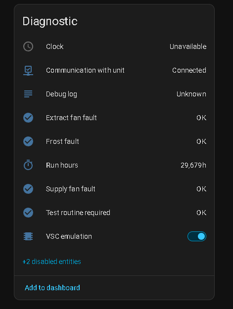
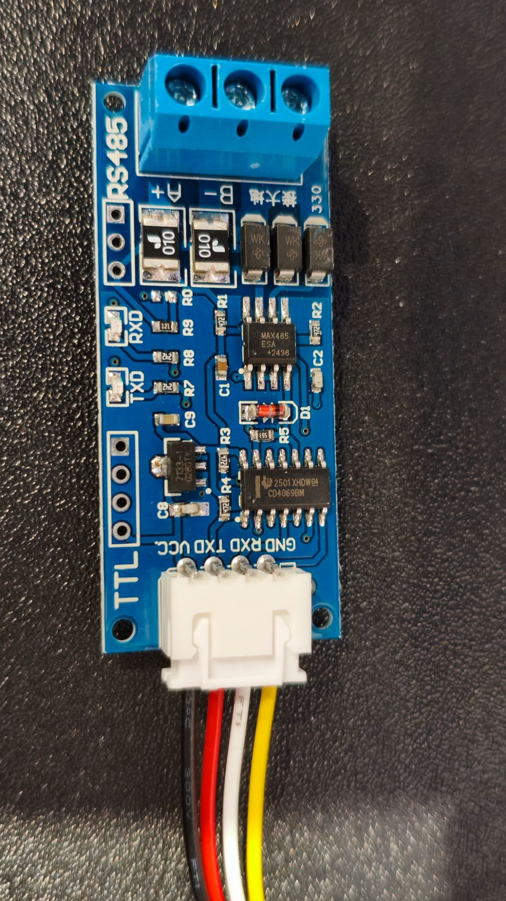
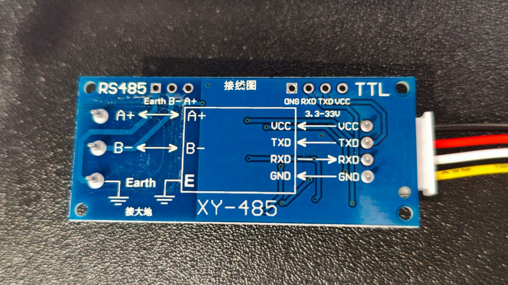

# Option 1: no VSC, the ESP answers the unit on RS485

The VSC (the wall controller) comes off the bus. An ESP32 with an XY-485 module answers the MRXBOX's polls in its place, and Home Assistant controls the unit over MQTT. No VSC, no SD card, no serial console.

Tested on one MRXBOX: every control in HA was checked against the bus, and the fan speeds by ear.



## Parts

| Part | Notes |
|---|---|
| ESP32 dev board | "ESP32 Dev Module" type (ESP32-WROOM) |
| XY-485 auto-direction RS485 module | Or another 3.3 V-logic RS485 module. Remove any 120 Ω terminator. |
| Adjustable buck module, LM2596 type | Takes the bus's +10 V down to 5 V for the ESP. A 5 V USB supply also works. |
| Jumper wires, small screw connectors or Wagos | For tapping the four bus wires |
| USB data cable | For flashing the ESP once |

Home Assistant needs an MQTT broker (the Mosquitto add-on) and the MQTT integration, and the ESP needs a 2.4 GHz WiFi network.

## Wiring


Turn the unit off at its isolator before you touch the bus wires.

| Bus wire | Goes to |
|---|---|
| red (+10 V) | buck module IN+ **only** |
| blue (0 V) | buck module IN−, ESP GND, XY-485 GND |
| yellow | XY-485 A+ |
| green | XY-485 B− |

| Buck module / XY-485 | ESP32 |
|---|---|
| buck OUT+ (5.0 V) | VIN |
| buck OUT− | GND |
| XY-485 VCC | VIN (5 V) |
| XY-485 RXD | GPIO25 |
| XY-485 TXD | GPIO26 |

 

- **Set the buck module to 5.0 V before you connect the ESP.** Power it from the bus (or a bench supply), turn the pot until a meter reads 5.0 V on OUT+, then wire the ESP.
- **Red never goes directly to the ESP or the XY-485.** Only to the buck module's input.
- The XY-485 has no DE/RE pins. It sends when TXD goes low, so TXD must be on GPIO26: the firmware holds it high from boot, which keeps the module in receive. Don't leave TXD floating.
- Go by the module's printed labels, not the colours of its flying leads.
- If you see no traffic on `/bus`, swap A+ and B− (power off first). On the tested unit it only decodes with A+ on yellow.
- The ground link (blue to the module's and the ESP's GND) is required.
- Disconnect the VSC from the four bus wires. **Don't run the emulation with a VSC powered on the same bus:** both would answer the same polls and garble every frame.

## Set up

### 1. Note the VSC's settings first

The bridge starts with factory defaults, so copy your values from the VSC screen before you take it off. The Commissioning menu is under **Settings → spanner → PIN**, installer PIN `1234`:

- airflow % for supply and extract at speeds 1, 2 and 3;
- bypass setpoint, humidity setpoint and frost level;
- run hours and filter hours (**Settings → Diagnostics**).

### 2. Flash the ESP and join it to WiFi

Follow [Setup in the bridge README](../esp/vsc-serial-bridge/README.md#setup): Arduino IDE with the Espressif esp32 package, board **ESP32 Dev Module**, upload `esp/vsc-serial-bridge/vsc-serial-bridge.ino`. On first boot join its `vsc-bridge` network (password `nuaire123`) and pick your WiFi.

### 3. MQTT

Open `http://vsc-bridge.local/` and fill in the MQTT section: the HA address (no `http://`), port `1883`, and an HA user and password. An **MRXBOX** device appears in HA under Settings → Devices & services → MQTT.

### 4. Check the bus

With the unit on, `http://vsc-bridge.local/bus` should show frames such as `84 …`, `AE …` and `C5 …` scrolling about three times a second. If it shows none, fix the wiring before you go on. The unit runs on its own defaults at its hard-wired speed while nobody answers; that's normal.

### 5. Turn on the emulation

In HA, on the MRXBOX device, turn on **VSC emulation** (without HA: `curl -X POST -d on=1 http://vsc-bridge.local/emu`). Within a few seconds:

- **Communication with unit** shows **Connected**;
- the controls (speed, bypass, setpoints, modes, airflow, timers) become available;
- temperatures, RH and bypass state come from the unit.

### 6. Enter your settings

Set the airflow %, setpoints and timer lengths in HA (airflow and timer entities are in the device's Configuration section), or on `/unit`. Carry the hours over once:

```bash
curl -X POST -d "run=12345&filt=2345" http://vsc-bridge.local/emu
```

Use your own numbers, in whole hours.

### 7. Check it

- Set speed 3, then speed 1. The fans speed up and slow down within a second or two.
- Set the bypass to On. **Bypass active** turns on within about a minute, and goes back when you set Auto.
- `http://vsc-bridge.local/emu` shows the bytes being sent: `sent` keeps rising and `late` stays near 0.

## The web page

`http://vsc-bridge.local/unit` shows the unit's readings and lets you change the speed, bypass, setpoints and modes without HA. It works in both options. `/emu` gives the emulation's raw state as JSON.

## What "VSC emulation" is

The VSC is two parts: the touchscreen program `es-lcd` (Linux) and a bus chip that talks to the unit. The unit is the bus master. It runs a fixed cycle of frames, and in four of them it polls the VSC:

| Slot | What the VSC answers | Emulation sends |
|---|---|---|
| `88` | status (speed 1 vs 2/3) | `6F` at speed 1, `6B` at speed 2 or 3 |
| `8A` | requested speed | `7F` / `1F` / `17` in byte 2 for speed 1 / 2 / 3 |
| `AE` | mode flags, bypass setpoint, humidity setpoint, frost level | the settings from HA |
| `C5` | six airflow % (supply and extract for each speed) | the airflow % from HA |

If nobody answers, the unit fills the slots with its own defaults. The emulation reproduces the bytes the VSC puts on the wire, not its program. Byte-level detail: [protocol.md](protocol.md#answering-the-polls-option-1).

### What the unit decides, and what the controller decides

- **The unit decides** whether the bypass opens (from the bypass setpoint and its own temperatures, re-checked about once a minute), humidity boost (from the humidity setpoint and its RH sensor), frost protection, and the actual fan speeds. It reports temperatures, RH, the bypass state and faults, which the bridge reads.
- **The controller decides** what to ask for: speed, modes and setpoints. With the VSC that is `es-lcd`; with option 1 it is the bridge, driven by HA.

### What the bridge does in `es-lcd`'s place

- **Modes, as `AE` byte 1 (active low):** `7F` none, `7E` bypass override On, `6F` bypass Off (forces heat recovery), `77` night, `7B` holiday, `7D` rising boost.
- **Timers.** Each returns the unit to normal when it runs out:

  | HA entity | Range | When it ends |
  |---|---|---|
  | Speed 3 time limit | 1–59 min | back to the speed before speed 3 |
  | Night mode length | 4–8 h | night off |
  | Holiday length | 1–21 days | holiday off |
  | Bypass override length | 1–12 h | bypass back to Auto |

  A length of 0 means no limit. **Time left** shows what is running. Timers carry on after an ESP restart; they count on a minute tick, so one can end up to a minute early.
- **Starting a bypass override cancels night, holiday and rising boost,** as `es-lcd` does.
- **Run hours and filter hours** count while the unit answers and are saved every 15 minutes. **Filter change due** comes on at 8760 h, as on the VSC.
- **Settings are kept in flash:** speed, modes, setpoints, airflow and timer lengths survive a power cut.

### What you lose without the VSC

- **Clock** and **Debug log** come from the VSC's Linux console, so they show Unavailable. Nothing needs them: the unit has no clock.
- **Screen timeout** belongs to the VSC's touchscreen.
- There is no wall screen. Control is HA or `/unit`.

## Going back to the VSC

Turn **VSC emulation** off. The bridge stops transmitting at once. Isolate the unit, reconnect the VSC to the bus and power up. To keep HA with the VSC, use [option 2](option2-vsc-console.md).

## Things to know

- **If the ESP stops** (power cut, crash), the unit carries on with its own defaults at the hard-wired speed, not the last speed HA set. The bridge picks up again when it restarts.
- **No login on the bridge.** Anyone on your network can use its pages, telnet (23), bus port (2323) and OTA (3232). Keep it on a trusted network and never forward its ports.
- **Checked by frame only:** the humidity setpoint and frost level produce the same bytes as the VSC, but the unit's reaction wasn't seen (RH stayed below the setpoint and the intake air above 0 °C).
