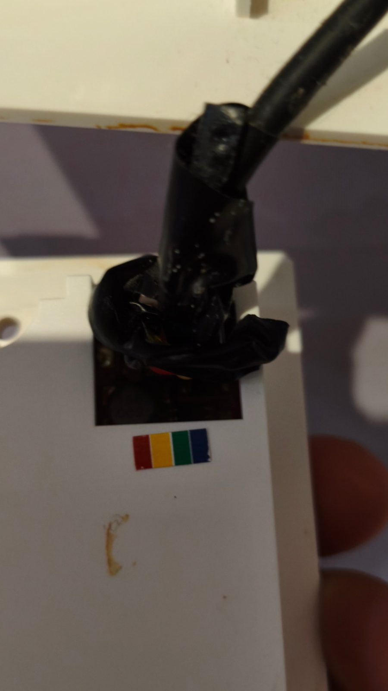
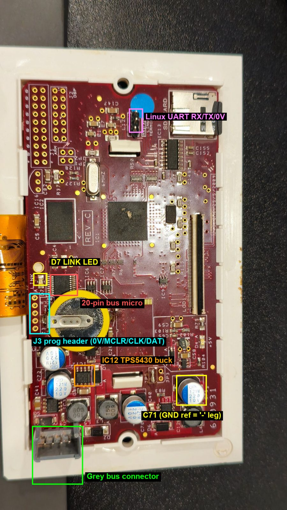
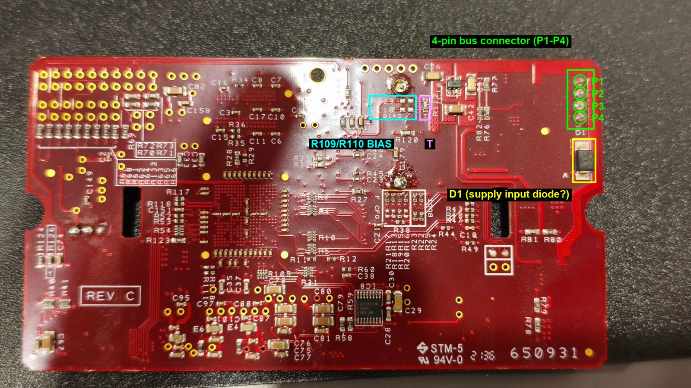

# Nuaire MVHR controller (es-lcd V0.26 Feb 2016): options map

Decoded from the `es-lcd` disassembly. `S0` means the 32-bit settings word at 0x6ab70; its bytes are frame bytes d0..d3 of the `20 d0..d10` frame. Airflow values live at 0x708ac and go out as d5..d10.

## PINs and hidden screens
- Installer PIN: stored at 0x708fa (default **1234**). The master PIN **0107** always works.
- Settings → spanner key (0x63) → PIN → Commissioning (screen 37).
- Commissioning → change-PIN key: type 4 digits and press Enter; the new PIN is saved by SaveSetup.
- If the stored PIN is reset to 1234 it goes back to screen 2; otherwise 0x22.
- `EXITDV` → screen 36 (shows /logread.log). It is 6 characters, but entry is limited to 4, so it can't be typed.
- Settings logo (key 0x4e) does nothing in stock firmware; the debug page uses it.
- Maintenance → key 0x72 resets the run-time counter (0x1e30c).

## Menus
- **Settings (1):** User Options 19, User Guide 20, Commissioning (PIN), Maintenance 35, Diagnostics 33, Home 2.
- **User Options (19):** Boost Timer 5, Contact 23, Night 15, Holiday 16, Rising Boost 6, Bypass Override 18, Date/Time 14.
- **Commissioning (37):** Air Flow 8, Change PIN, Frost 21, Run Time 4, Bypass Setpoint 30, Humidity 3.
- **Commissioning wizard** (the "n" next key): 8 Supply → 9 Extract → 21 Frost → 30 Bypass → 3 Humidity → 4 Run Time.

## Settings: range, storage and frame byte

| Screen | Setting | Range / step | Default | Stored in | On the wire |
|---|---|---|---|---|---|
| 3 Humidity | RH boost setpoint | 50–85 % / 1 | 65 ("s" key) | S0 bits 17–23 | d2 >> 1 |
| 30 Summer bypass setpoint | Bypass temperature | 15–30 °C / 1 | – | S0 bits 10–15 | d1 >> 2 |
| 30 (key "s") | Bypass setpoint timer toggle | 0 or 480 | | 0x1e31c | (local) |
| 21 Frost protection | Frost level | 0 to −5 / 1 | – | 0x708c4 (s16); S0 bits 28–31 = −value | d3 >> 4 |
| 21 (key "s") | Frost timer toggle | 0 or 480 | | 0x1e31e | (local) |
| 8 Air Flow Supply | 3 speeds | each 0–100 % / 1, speed1 ≤ speed2 | – | 0x1e2af / 0x1e2ae / 0x1e2ad | 0x708ac bytes 2 / 3 / 0, value << 1 |
| 9 Air Flow Extract | 3 speeds | same | – | (same pattern) | remaining 0x708ac bytes |
| 6 Rising Boost | Enable | Yes / No | | S0 bit 6 (0 = Yes) | d0 & 0x40 (active low) |
| 5 Boost Timer | Boost duration | 1–59 min; 60 = "None" (no limit) | | 0x708c2 | (local timer) |
| 15 Night mode | Duration | 4–8 h | | 0x1e2dd; running timer 0x1e324 = h × 60 min | d0 & 0x10 (active low) |
| 16 Holiday mode | Duration | 1–21 days | | 0x1e2df; timer 0x1e322 = days × 1440 min | d0 & 0x20 (active low) |
| 18 Bypass override | Duration | 1–12 h | | 0x1e2a9; timer 0x1e320 = h × 60 min | d0 & 0x80 |

When the bypass override starts, it clears d0 bit 7 (override on) and bit 0, and it sets bits 4–6, which cancels Holiday, Night and Rising Boost. Stopping the override sets bit 7 again.

**Summer bypass setpoint** (for example "bypass 24C"): above this inside temperature the unit opens the summer bypass so fresh air skips the heat exchanger (free cooling), as long as it is cooler outside. It is the setpoint, not the live damper state.

## I²C framing (MSP430 at 0x26)
- **Write (TX):** `cmd, data[0..n-1], chk` where `chk = ~(data[0] ^ … ^ data[n-1])`. The settings frame is `cmd 0x20`, n = 11. A 100 µs pause follows.
- **Read (RX):** write 3 bytes `00, req, ~req`, wait 100 µs, then read 28 bytes. The first 8 are skipped; bytes 8–27 become payload p0..p19.
  - `req` = 0x01 normally. While a boost countdown runs (0x708c0 ≠ 0): 0x0c, or 0x0d if 0x708ca is set.
  - Live (debug page 2, logger v5): pressing boost sends `0c` exactly **once**, then `0d` on every poll until boost ends. The reply to the `0c` itself is identical to a normal `01` reply (p7 f6, p11 fe, p15 ab). The acknowledgement first appears in the next (`0d`) reply: p7 d6, p11 e8, p15 9d.
- The exchange runs every 30 ticks: RX at tick 1, TX at tick 15. A TX that succeeds prints "Success!".

## TX frame `20 d0..d10`
| Byte | Meaning |
|---|---|
| d0 | Mode flags, all active low. 0x80 bypass override, 0x40 Rising Boost, 0x20 Holiday, 0x10 Night, 0x08 bypass-setpoint "s" timer running (0x1e31c), 0x04 frost "s" timer running (0x1e31e). Bit 0 is always cleared. |
| d1 | Bypass setpoint << 2 |
| d2 | Humidity setpoint << 1 |
| d3 | (−frost level) << 4 |
| d4 | Checksum `~(d0^d1^d2^d3)` |
| d5..d10 | Airflow bytes 0x708ac[0..5], each %·2 (supply/extract × 3 speeds) |

Starting a timed mode sets bits 4–7 and then clears its own bit, so only one mode is active at a time.

## RX payload p0..p19
| Byte | Meaning | Stored at |
|---|---|---|
| p0 | Minutes, BCD (&0x7f) | 0x6ab5e |
| p1 | Hours, BCD (&0x3f) | 0x6ab5c |
| p2 | Day, BCD | struct tm |
| p3 | Month (bit 4 = +10, low nibble) | struct tm |
| p4 | Year, BCD (+70 → tm_year) | struct tm → mktime → 0x7080c |
| p5 | Inside temp: p5>>1, signed 7-bit, °C. −63 means sensor fault ("Error") | 0x708c6 |
| p6 | ~p5 (check byte) | – |
| p7 | Only used in the checksum. Live capture: f6 normally, bit 0x20 clears (d6) while the unit is boosting | – |
| **p8** | **Fault flags A** (active low, see below) | 0x6ab68 |
| **p9** | **Fault flags B / fan state** (active low, see below) | 0x6ab69 |
| p10–p12 | Only used in the checksum. Live capture: p11 fe normally, f8 (0x06 clear) once boost req 0c is acknowledged, e8 (0x10 also clear) after req 0d; back to fe about 2 s after req returns to 01 | – |
| p13, p14 | Bit-reversed active-low value → 0x1e376. Written by byFsa only; nothing else reads it, so it is unused in this firmware | 0x1e376 |
| p15 | Checksum `~(p7^…^p14)` | – |
| p16 | Outside temp: p16>>1, signed 7-bit, °C; −63 = fault | 0x708c8 |
| p17 | ~p16 (check byte); mismatch prints "Outside temp checksum error" | – |
| p18 | **Humidity %**: v = p18>>1, active low and bit-reversed (bit 6 clear = +1 … bit 0 clear = +64). 0 or 127 = sensor fault (Diagnostics "Humidity Sensor" row). Live: 2a → 43 %, ca → 44 %, 4a → 45 %, 8a → 46 %, 0a → 47 %, f2 → 48 % | 0x708cb |
| p19 | Same encoding as p18; no reader found. Live: 0x54 → 85 | 0x708cc |

The 8 header bytes of every reply (before p0) were 00 in runs 1 and 2. In run 3 (logger v5) they were `60 84 00 e5 c8 c8 24 40` in every reply, which is d1..d8 of the settings frame sent just before. es-lcd ignores them. Debug page 2 shows the same 8 bytes in the replies to `01`, `0c` and `0d` alike, so they don't depend on the request: the MSP430 most likely just returns its last receive buffer. An ESP can ignore them.

p8 = p9 = 0xff means "No communications" (every Diagnostics row shows "?" and the comms row a cross). A change in p1, p5, p8, p9 or p16 triggers a redraw.

### p8 bits (0 = fault)
| Bit | Status line (Settings/Menu screen) | Diagnostics row |
|---|---|---|
| 0x40 | "Heater fail" (checked first) | – |
| 0x80 | "Cooler fail" | – |
| 0x08 | "Fan 1 fail" | Row 3 (y 0x88) |
| 0x20 | "Fan 2 fail" | Row 1 (y 0x58) |

The fan bars on Home are drawn coloured only when both 0x08 and 0x20 are set (both fans OK); otherwise they are grey.

### p9 bits (0 = active/fault)
| Bit | Meaning |
|---|---|
| 0x20 | "Frost fail" on the status line (lowest priority; otherwise "OK") |
| 0x04 | Clear → "Test routine required!", and 0x1e334 = 1. Also lights fan bar 3 |
| 0x02 | With 0x04, lights fan bar 2: bar 2 is lit unless both bits are set |

So p9 bits 1–2 report the running fan speed: both set = speed 1, 0x02 clear = speed 2, 0x04 clear = speed 3.

### Diagnostics screen (33), top to bottom (labels confirmed from `Diagnostics.png`)
1. Extractor Fan: p8 0x20 (so "Fan 2" = extract)
2. Extractor Temp. Sensor: p5 ≠ −63 (so "inside temp" is the extract-air temperature)
3. Supply Fan: p8 0x08 (so "Fan 1" = supply)
4. Supply Fan Temp. Sensor: p16 ≠ −63 (so "outside temp" is the fresh-air intake temperature)
5. Humidity Sensor: p18 not 0 or 127 (so p18 = relative humidity %)
6. Communication With Unit: p8/p9 not both 0xff

## Home screen (2)
- Outside temp at top left, inside temp below; "Error" if −63.
- **Frost icon:** shown when outside temp ≤ frost level (0x708c4), the sensor is OK and the frost "s" timer is not running.
- **Mode icon:** Night (d0 0x10 clear), else Holiday (0x20 clear), else summer icon when the bypass override (0x80) is clear.
- **Filter-change icon:** run hours (0x1e30c) > 8759, i.e. one year. Maintenance key 0x72 resets it.
- Fan bars: see the p8/p9 notes. Extra bar segments while boost (0x708c0) or 0x708ca is active.

## Test routine (screen, key-driven)
A touchscreen test: touch the four corners (keys 0x31–0x34) and the centre box (0x35). When all 5 are done (mask 0x1f) it shows "V0.26 Feb 2016", the system type, the time and "Test routine completed". Key 0x20 resets it. It is prompted by p9 bit 0x04.

## CO2 sensor support (library only)
`msp430lib_get_co2` uses a separate I²C handle (CO2lib_init). It writes `22 00 08 2a` (a Senseair K30-style "read RAM 0x08" command), waits 20 ms, reads 4 bytes, and returns CO2 ppm = b1·256 + b2. No screen in this firmware shows it.

## Wiring: VSC to MRXBOX (4-core bus cable)

The wall box has a colour label red / yellow / green / blue next to the cable entry. Measured on my unit with the VSC powered and connected, meter black probe on blue:

| Wire | Signal | Measured |
|---|---|---|
| Red | Supply + | +10 V, steady |
| Blue | 0 V / GND | reference |
| Green | RS485 A (D+) | 1–2 V, jumping with traffic |
| Yellow | RS485 B (D−) | 1–2 V, jumping with traffic |

- Red probe on yellow, black on green reads slightly negative (under 0.5 V), so green idles higher and is A. The difference is small and the meter averages over traffic, and some vendors label A/B the other way round. If a tap decodes garbage or inverted bytes, swap green and yellow; it does no harm.
- Blue → C71 "−" leg (board ground) should read ~0 Ω with power off. Not yet checked.
- Listen-only tap (e.g. MAX3485 at 3.3 V): A ← green, B ← yellow, GND ← blue, RO → ESP RX, DE and /RE tied to GND. **Red (supply) must never connect to the ESP.**



### VSC board (Rev C, 650931)





- **Grey 4-pin connector** (front, bottom left) is the bus cable. On the back its pads are P1–P4, with D1 (SMA diode, likely supply-input protection) next to one end pad.
- **R109/R110 "BIAS"** and **"T"** (termination) on the back sit on the RS485 pair; the traces run to the two middle pads, so data is in the middle and power on the outer pins.
- **IC12** "5430" is a TPS5430 buck regulator (with L3/L4/L5 15 µH, D2/D5/D6). C71 (220 µF / 10 V) is a handy ground point at its "−" leg.
- **D7 "LINK"** LED blinks with bus traffic.
- **20-pin TSSOP** next to J3 is most likely the bus micro (the firmware calls it msp430). **J3** is labelled 0V / MCLR / CLK / DAT, a PIC-style ICSP header, so the part number still needs reading off the chip.
- **Linux serial console** RX / TX / 0V header is next to the SD card.
- The RS485 transceiver chip has not been identified from the photos yet.

Close-ups: [bus connector, front](images/bus_connector_front.jpg), [bus pads, back](images/bus_pads_back.jpg).

## RS485 cross-reference (prior art)

@jamesgrogantech posted an RS485 capture of the same bus on the [HA forum thread](https://community.home-assistant.io/t/nuaire-mrxbox-interface-for-home-assistant/573933): 1200 baud 8N1, bytes sent MSB-first (a normal UART sees them bit-reversed), a burst of 9 messages repeating about every 0.7 s:

```
21 AA F4 D4
11 F6 4C
51 FE FE FE 04
31 FE FE 9A
33 FE FE 98
85 2E FE 30 FE FE CE
A3 FE … 08
75 FE … DE
3B C2 54 06
```

How that lines up with the I²C fields above:

| RS485 | I²C | Note |
|---|---|---|
| `21` byte 1 = `AA` | p8 = `aa` | Fault flags A ("Flt: Htr") |
| `21` byte 2 bit 0x02 (F4 boost / F6 normal) | p7 f6 → d6 on boost | Boost state; exact bit mapping still to confirm |
| `3B` byte 1 (C2 → 67 % reversed) | p18 | RH, same bit-reversed active-low encoding |
| `3B` byte 2 = `54` | p19 = `54` | Same value; meaning still open |

His capture has no temperatures in the broadcast, the checksum is unknown, and replaying a boost message did not work. Lining up a simultaneous RS485 + I²C capture is the next step.

## Still open
- p7, p11: boost acknowledgement bits (see table); exact meaning of each bit still open. p10, p12 constant so far. Run 3: pressing speed 3 (boost) on Home sent req 0c and then 0d, which stayed for about 26 minutes (from 158 s to the end), with p11 at e8 throughout; p15 follows as the checksum (ab → 8b → 8d → 9d). p9 stayed f6 (the speed-1 pattern) the whole time, so the p9 speed bits don't reflect boost; the v5 debug page also shows "Spd 1" during boost. Use p7 bit 0x20 / p11 to detect boost.
- Reply header bytes: zero in runs 1–2, but an echo of TX d1..d8 from run 3 on, identical for every req (see above).
- p19 meaning (no reader in es-lcd). The RS485 bus capture posted on the HA forum shows a `3B C2 54 06` message whose byte 2 is also 0x54, so p19 likely mirrors that field.
- p8 = 0xaa has bit 0x40 clear ("Heater fail"): check what the Settings status line shows on the real unit (possibly no heater fitted). The v5 debug page decodes it as "Flt: Htr", with both fan bits OK.
