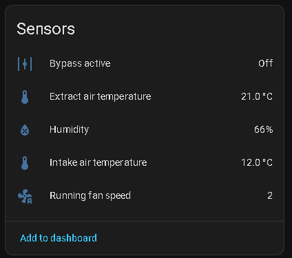
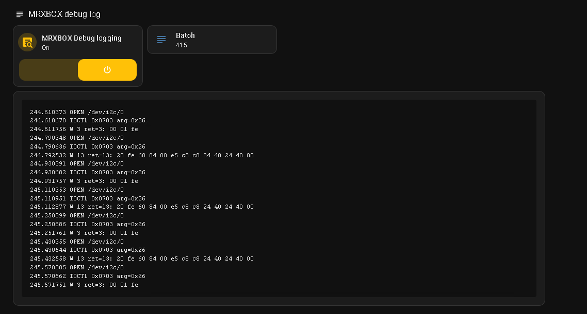
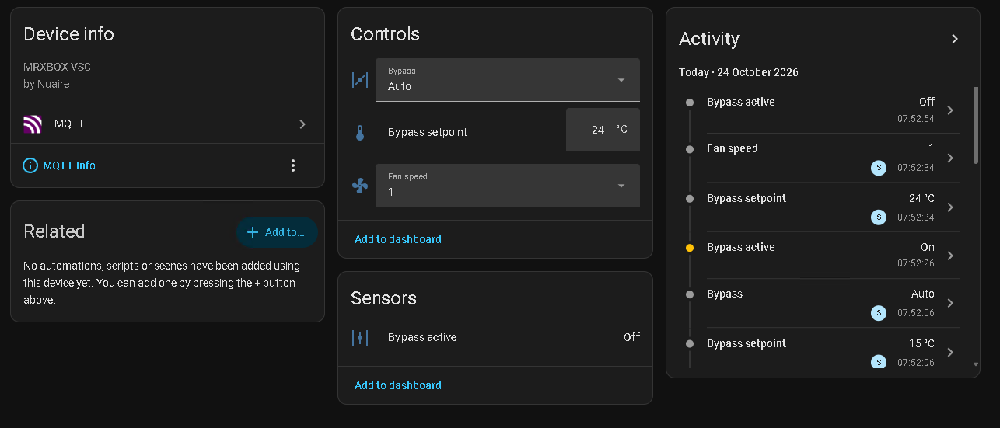
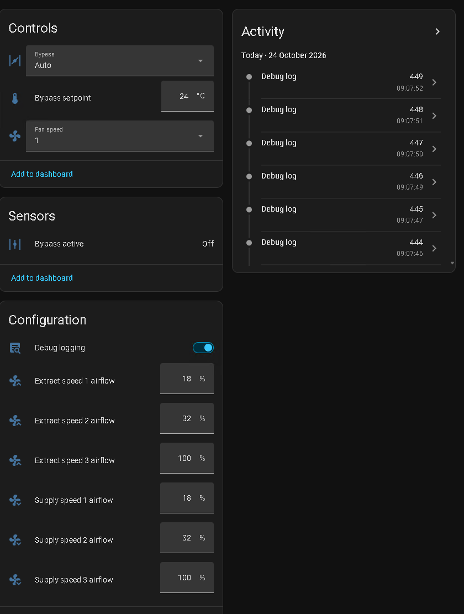

# VSC serial bridge (ESP32)

The ESP32 firmware for both options in this repo:

- **Option 1, no VSC** ([how-to](../../docs/option1-no-vsc.md)): an XY-485 module on the RS485 bus, and the bridge answers the MRXBOX in the VSC's place (**VSC emulation**).
- **Option 2, keep the VSC** ([how-to](../../docs/option2-vsc-console.md)): wired to the VSC's **LINUX TERMINAL** console header. You get the console in a browser or over telnet, and the bridge drives the VSC from it.

Both put an **MRXBOX** device into Home Assistant by MQTT, and both have a web page at `/unit`.

## Wiring

Tested on an ESP32 dev board ("ESP32 Dev Module" in Arduino): [the one I used](https://link.amazon/B0fLi8rTD).

### Power

From the bus cable through an adjustable 5 V buck module (LM2596 type), or from USB:

| From | To |
|---|---|
| red (+10 V) | buck module IN+ **only** |
| blue (0 V) | buck module IN− |
| buck OUT+ (5.0 V) | ESP VIN |
| buck OUT− | ESP GND |

- Set the buck module to 5.0 V with a meter before you connect the ESP.
- **Red never goes directly to the ESP**, only to the buck module's input.
- Turn the unit off at its isolator before you touch any wiring.

### Console header (option 2)

The header next to the SD card is silkscreened **LINUX TERMINAL** (0V, TX, RX; 0V is the pin nearest the blue sticker). TX/RX are named from the VSC's side.

| VSC LINUX TERMINAL | ESP32 |
|---|---|
| TX | 10 kΩ resistor → GPIO16 (RX) |
| RX | GPIO17 (TX), direct |
| 0V | GND |

- The header is RS232 level: TX idles at about −5 V (IC13 beside it is a MAX3232-type transceiver). The 10 kΩ resistor limits the current into GPIO16, and the bridge's polarity setting **RS232 (inverted)**, the default, undoes the inversion. The VSC's RX accepts the ESP's 3.3 V directly. Sending and receiving both work this way.
- **Alternative: a MAX3232 RS232-to-TTL module** in between (VCC to 3V3, TTL out to GPIO16, TTL in to GPIO17, RS232 in from VSC TX, RS232 out to VSC RX). Then set the bridge to **TTL (normal)** with the inv button. Diagram: [vsc-console-wiring.svg](../../docs/images/vsc-console-wiring.svg).
- On a WROVER module, GPIO16/17 are taken by PSRAM. Change `VSC_RX_PIN` / `VSC_TX_PIN` (for example to 32/33).
- If you see nothing at all, TX and RX are probably swapped.

### RS485 module (option 1)

An **XY-485 auto-direction module** ([the one I used](https://link.amazon/B0ftIGEMN)). It has no DE/RE pins. Go by the printed labels, not the colours of its cable:

| XY-485 | Cable colour | Connect to |
|---|---|---|
| VCC | black | ESP **VIN** (5 V). The board's own 3.3 V regulator feeds the chip, so RXD stays at 3.3 V |
| GND | yellow | ESP GND **and** blue bus wire (0 V) |
| RXD | white | ESP **GPIO25** |
| TXD | red | ESP **GPIO26**. The firmware holds it high except while it sends, which keeps the module in receive. Never leave it floating: a low TXD makes the module drive the bus |
| A+ | | **yellow** bus wire |
| B- | | **green** bus wire |
| Earth | | not connected |

 

- On my unit the module only decoded with **A+ on yellow and B- on green**. With them the other way round, the RXD pin never moved at all. If you see no traffic, swap them (power off first).
- The XY-485 measured about 22 kΩ across A+/B- (bias resistors, no termination), so nothing needs removing. On other modules, remove a 120 Ω termination resistor (often marked 121): the bus is already terminated.
- The ground link (blue to module GND) is required. Without it the receiver sees nothing.
- The chip on the XY-485 is a MAX485 (a 5 V part) run at 3.3 V by the board's regulator. It works on my unit, but a MAX3485 is the in-spec part.
- With the VSC still on the bus, the module only watches the traffic (`/bus`). Turn on **VSC emulation** only with the VSC disconnected: both would answer the same polls.
- `/status` shows `bus_edges` and `bus_level`, which count level changes on GPIO25 at any baud rate. If edges stay at 0, the module isn't switching (check ground, then swap A/B).

## Setup

1. Arduino IDE with the ESP32 board package (Espressif `esp32`). Board: "ESP32 Dev Module".
2. Flash over USB once. After that you can reflash over WiFi: in Arduino IDE pick the network port `vsc-bridge`, or from the command line run `espota.exe -i <ip> -p 3232 -f vsc-serial-bridge.ino.bin -r` (espota is in the esp32 core's `tools` folder).
3. WiFi is set on the device, not in the code. It needs a 2.4 GHz network. On first boot the ESP starts its own network `vsc-bridge` (password `nuaire123`). Join it from a phone; the setup page opens by itself (or open `http://192.168.4.1/`). Scan, pick your network and enter its password. The ESP saves them and restarts onto your network.
4. If it can't reach the saved network for a minute, or you hold the BOOT button for 3 s, it starts the `vsc-bridge` network again so you can fix the settings. Once it is back on your network the `vsc-bridge` network turns off after 5 min unused. You can change the settings any time at `http://vsc-bridge.local/`, which also shows the bridge's status. The old console page is at `/console`.

## Use

- **Unit page:** `http://vsc-bridge.local/unit` shows the MRXBOX readings and sets speed, bypass, setpoints, modes and airflow, without HA. It works in both options. `/unit/state` gives the same as JSON.
- **VSC emulation (option 1):** `/emu` gives the emulation's state as JSON. POST `on=1` / `on=0` turns it on or off, and `run=` / `filt=` set the run and filter hours.
- **Console (option 2):** `http://vsc-bridge.local/console`. The console page has the live log (last 16 KB), a line to send commands, Ctrl-C and Enter buttons, a baud rate selector, a **TX on/off** switch and the **RS232 (inverted) / TTL (normal)** polarity switch, which is saved across reboots. With TX off, the bridge only listens and nothing reaches the VSC. TX goes back to on after the ESP restarts.
- **Telnet:** PuTTY, connection type **Raw**, host `vsc-bridge.local`, port 23. One client at a time.
- **Plain log:** `http://vsc-bridge.local/log`. **Status JSON:** `/status`.
- **Upload a file to the VSC:** on the console page pick a file, type where it goes (for example `/k8.so`) and press Upload. Or from a PC: `curl -F f=@k8.so "http://vsc-bridge.local/upload?to=/k8.so"`, then `GET /upload` until `state` is `ok`. The bridge types the file to the shell (needs a root prompt and TX on), decodes it to `<path>.up` and renames it over `<path>`, so replacing a file in use is safe. It then checks the unit's md5 against its own. Up to 64 KB; about 15 s for 20 KB. The MQTT poll and `/send` wait while it runs.
- **RS485 bus:** `http://vsc-bridge.local/bus`, or raw TCP port **2323** (read only). One line per frame: seconds since the ESP booted, ms since the previous frame, then the bytes in hex. A frame ends after 20 ms of silence. The default is 1200 baud with bits shown **MSB first**, because the bus sends bytes MSB first and a UART receives them bit-reversed (from the HA forum capture). Both settings are on the page and saved across reboots. Plain text at `/buslog`.

The default is 115200 8N1, the usual DM355 console speed. If the log shows garbage, try other rates from the dropdown.

## Home Assistant (MQTT)

The bridge puts the MRXBOX into Home Assistant by MQTT discovery. In option 2 it needs `logger/i2clog.so` on the VSC (the `/tmp` control files, added by `vscconv.exe`) and TX on. In option 1 it drives the emulation instead, and the list below is the same except where marked.

1. Open `http://vsc-bridge.local/` and, in the MQTT section, enter the broker (for the Mosquitto add-on: the HA address, port 1883, and an HA user or Mosquitto login). The login is saved on the ESP only. Leave the host empty to turn MQTT off.
2. A device **MRXBOX** appears with:
   - **Fan speed** (select 1/2/3)
   - **Bypass** (select Auto/On/Off)
   - **Bypass setpoint** (15–30 °C). The unit can't report it, so HA shows the last value sent. Saved on the VSC (see below).
   - **Humidity setpoint** (50–85 %) and **Frost protection level** (0 to −5 °C), read back from `/tmp/modes`. Saved on the VSC.
   - **Night mode** and **Holiday mode** (switches): what the Night/Holiday screen keys do, for the hours/days set on the screen. In HASSOS mode their timers are held, so they stay on until turned off. Saved on the VSC; after a restart they start again for the full time. The icons on the screen still need checking (**requires further testing**).
   - **Screen timeout** (0–120 min, 0 = never sleep). Saved on the VSC. Option 2 only.
   - **Option 1 only:** **VSC emulation** (switch, under Diagnostic), **Rising humidity boost** (switch), **Speed 3 time limit**, **Night mode length**, **Holiday length** and **Bypass override length** (under Configuration), and **Time left**. See [option 1](../../docs/option1-no-vsc.md#what-the-bridge-does-in-es-lcds-place).
   - **Run hours** and **Filter hours** (from es-lcd's own counters, `/tmp/runtime`), **Filter change due** (on above 8759 filter hours, when es-lcd shows its filter icon) and the **Reset filter hours** button, which does what the Maintenance screen's filter reset does and saves it (**requires further testing**).
   - **Bypass active** (the unit's decision, `/tmp/bypass_state`)
   - **Humidity** (%), **Extract air temperature** and **Intake air temperature** (°C), from `/tmp/sensors`. Unknown when the unit reports the sensor as faulty.
   - **Running fan speed** (1/2/3): the speed the unit confirms it is running, not just the one requested. It comes from the unit's acknowledgement (p7 bit 0x20); the reply's own speed bits stay at speed 1, so they aren't used.

     
   - **Communication with unit** and the fault sensors **Supply fan fault**, **Extract fan fault** and **Frost fault** (under Diagnostic). The faults are unknown while there is no communication.
   - **When the VSC doesn't answer** (off, unplugged, wiring fault or not logged in): after 3 polls with no reply (about a minute) **Communication with unit** goes off and every other MRXBOX entity shows unavailable. They come back with the next reply. If the ESP itself goes offline, everything shows unavailable.
   - **Requires further testing:** **Heater fault**, **Cooler fault** and **Test routine required** (under Diagnostic). They are decoded the way es-lcd reads them, but not yet checked against a real fault. Heater and cooler are optional add-ons and my unit has neither: Heater fault shows ON there and Cooler fault OFF, so both are disabled in my HA. Disable them too if your unit has no heater or cooler. Test routine required uses a p9 bit that es-lcd also draws as fan bar 3.
   - **Supply / Extract speed 1/2/3 airflow** (1–100 %, under Configuration). Saved on the VSC.
   - **Clock** (sensor, under Diagnostic, option 2 only): the VSC's clock, `HH:MM`, from `/tmp/clock`. The bridge keeps it right by itself, with no HA automation: it gets the time by NTP (`pool.ntp.org`), and when the VSC is more than a minute out it sets it through `/tmp/settime`, at most every 5 minutes. es-lcd only reads the clock at speed 1, so the check waits for two polls in a row at speed 1. The time zone is UK by default; another one (POSIX TZ, e.g. `CET-1CEST,M3.5.0,M10.5.0/3`) goes in the time zone field on the MQTT page. This matters because one unit's clock had stopped at 04:00, and with it every per-minute countdown: the screen never went to sleep, and the speed 2/3, night and holiday timers never ran down. Tested: after a reboot the VSC came back at 00:00 and the bridge set it right on the first speed 1 polls.
   - **Saving:** everything set from HA lasts across a VSC restart. Airflow, bypass setpoint, humidity and frost go into es-lcd's own settings file (`setup3`, written by es-lcd's own save routine, the same file the screen's settings use). Night, holiday and frost are also kept in `/etc/modes`, and the screen timeout in `/etc/screen_timeout`. Tested: values changed from HA, VSC rebooted, all came back.
   - **Debug logging** (switch, under Configuration, option 2 only). Off by default and off again after a VSC restart. When on, `i2clog.so` writes its log to `/i2clog.txt` and the bridge publishes each line to `vsc/log` (not retained). To watch it: Settings → Devices & services → MQTT → Configure → Listen to a topic `vsc/log`.
   - **Debug log** (sensor, under Diagnostic). Once a second the bridge also sends the new log lines as one batch to `vsc/log_batch`. The state is the batch number and the `lines` attribute holds the lines. HA's recorder keeps every batch, so the log can be read back from the sensor's history (for example with the history API or an MCP tool), not only watched live. The text is in the `lines` attribute (open the sensor and expand Attributes). To show it on a dashboard, add a Markdown card with this content:

     ~~~jinja
     
     
     ```
     {{ l }}
     ```
     Debug logging is off.
     ~~~

     

   

   The airflow numbers and the Debug logging switch are under Configuration. The Activity list shows a new Debug log batch about every second while logging is on:

   
3. In option 2 the bridge types shell lines on the console: a state poll every 20 s and the `/tmp` file commands. If it sees `login:` it logs in as root, once. Until it has seen the `# ` shell prompt (after boot, or a `login:` / `Password:`), the poll sends only Enter and HA commands are ignored, so nothing is typed into the login (tested on a real VSC reboot). Those lines show up in the console log and any telnet session. The poll waits while `/send` is in use (30 s after the last line), so it can't break into a typed upload.

Topics are under `vsc/` (`vsc/speed`, `vsc/bypass`, `vsc/bypass_temp`, `vsc/bypass_state`, `vsc/humidity`, `vsc/temp_extract`, `vsc/temp_intake`, `vsc/fan_running`, `vsc/comms`, `vsc/fault_supply_fan`, `vsc/fault_extract_fan`, `vsc/fault_heater`, `vsc/fault_cooler`, `vsc/fault_frost`, `vsc/test_required`, `vsc/air_s1`…`vsc/air_s3`, `vsc/air_e1`…`vsc/air_e3`, `vsc/humidity_sp`, `vsc/frost_sp`, `vsc/night`, `vsc/holiday`, `vsc/screen_timeout`, `vsc/run_hours`, `vsc/filter_hours`, `vsc/filter_change`, `vsc/filter_reset`, `vsc/debug`, each with `/set` where HA can write; `vsc/log` carries the debug log, one line per message, and `vsc/log_batch` the same lines as JSON batches; `vsc/status` is online/offline for the ESP, `vsc/vsc_status` online/offline for the VSC answering the poll).

## Things to know (option 2)

- There is no U-Boot: the board uses its own "SD direct kernel boot" loader, so the boot can't be interrupted and keys sent during boot do nothing harmful. The kernel runs with `console=ttyS0,115200n8`.
- On the stock card, `es-lcd` runs in the foreground of the boot script and fills the console with `Init I2C` / `Success!`, so `getty` never starts and there is no login prompt.
- With a card converted by `vscconv.exe` (see [option 2](../../docs/option2-vsc-console.md)) or built by `tools/mkimg.py --shell`, `es-lcd` runs in the background and you get `login:`. Log in as `root` (no password). A full boot log and shell session is in [captures/vsc_console_boot.txt](../../captures/vsc_console_boot.txt).
- Everything you do from a shell is on the live SD card. Experiment on a copy of the card, never the original.

## Security

- The web pages, telnet (23), bus port (2323) and OTA update (3232) have no password, and the console is a root shell on the VSC. MQTT is unencrypted. Keep the ESP on a trusted network and never forward its ports to the internet.
