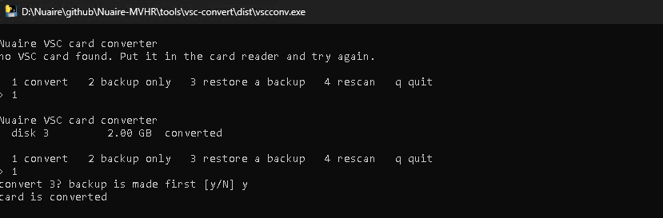

# VSC card converter

Converts the VSC's SD card in a PC card reader, so the ESP bridge (or a serial dongle on
the console header) can log in and read the unit. Home Assistant only connects
afterwards; it does not convert anything.

A stock VSC can't be converted over the console: es-lcd runs in the foreground of the
boot script with no shell, and Ctrl-C doesn't reach it. So the card has to come out once.

## What it does

1. Checks the card really is a VSC card (MBR layout, ext2 root, `es-lcd` present).
2. Checks the boot script is stock. Anything else is left alone.
3. Checks `es-lcd` is the tested build (by SHA256). `i2clog.so` calls fixed addresses
   inside it, so with another build the screen may not work. If it differs, nothing is
   changed unless you override: type `yes` in the menu, or add `--any-eslcd` on the
   command line. An overridden card **requires further testing**.
4. Makes a full backup of the card, reads the card a second time and checks the file,
   all by SHA256 (`vsc_backup_<date>.img` plus a `.sha256`).
5. Patches the root partition in place (26 blocks):
   - `i2clog.so` over the first blocks of `/etc/Wireless/RT2870STA/rt3070sta.ko`
     (the wifi module, never loaded on this unit);
   - `/autoexec.bat` starts es-lcd with `LD_PRELOAD` and in the background, so init
     reaches the console login.
6. Reads every written block back and checks the card now reads as converted.

**Restore** writes a backup back over the whole card and reads it all back to check it by
SHA256. It needs the backup's `.sha256` next to it with the same name, and refuses to
write if it is missing or doesn't match, so keep the two together. Menu option 3 offers
cards it recognises as a VSC card. Option 5 restores to a blank or replacement card: it
lists the removable disks (never the system disk) and asks you to type the disk number
again before it overwrites anything (**requires further testing** on a real card). See
[docs/option2-vsc-console.md](../../docs/option2-vsc-console.md#9-restore-and-recovery).

The backup is saved in the current folder and needs free space the size of the card.

## Windows

`vscconv.exe` (Python and `i2clog.so` are inside), from the
[latest release](https://github.com/karwantes/Nuaire-MVHR/releases/latest). Start it,
accept the admin prompt, pick 1 to convert. Close any Explorer window on the card first.



Build: `build_exe.ps1` (needs PyInstaller).

## Linux

```
sudo python3 vscconv.py
```

Same menu. Needs `i2clog.so` next to the script. Tested in WSL2 (Ubuntu) with the card
reader passed through by usbipd-win; a native Linux PC requires further testing.

## Command line

```
vscconv.py list
vscconv.py status  <disk number | /dev/sdX | file.img>
vscconv.py backup  <target> [file]
vscconv.py convert <target> [--any-eslcd]
vscconv.py restore <target> <backup.img>
```

`status` also says whether es-lcd is the tested build.

## Tested

- Convert, re-convert (no-op) and restore on image copies of a stock card: changes only
  the expected blocks, restore gives back the stock image bit for bit.
- On a real card in a USB reader (Windows EXE): backup checked, 26 writes verified. The
  converted card booted in the VSC, the ESP bridge logged in and read the unit.
- On the same real card in WSL2: status, backup, restore of the stock backup (read back
  identical, status `stock`), then convert again (26 writes verified). The card then
  matched a converted copy of the stock image bit for bit.
- es-lcd check, on image copies: a copy with one es-lcd byte changed is refused with
  nothing written (no backup either), and converts with `--any-eslcd`.
- Restore checks, on image copies: refused with the `.sha256` missing or wrong (target
  untouched), restored and verified with the right one.
- Booting a restored stock card in the VSC, and restoring to a blank or replacement card:
  **requires further testing**.
- Release vscconv-1.1 (exe), on an image copy: status, es-lcd check, backup, convert (26
  writes verified), and restore refused without the `.sha256`. Same `i2clog.so` as 1.0,
  so the same 26 writes.

Step-by-step guide with parts and wiring: [docs/option2-vsc-console.md](../../docs/option2-vsc-console.md).
